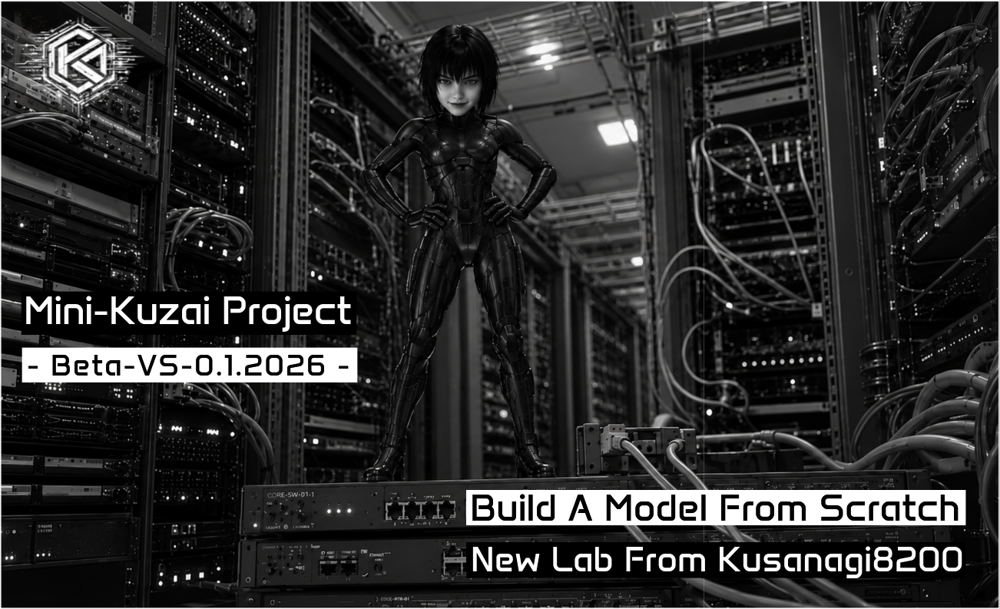

#### **`Mini-Kuzai - LLM`**

#### **`BUILD A LANGUAGE MODEL FROM SCRATCH, TRAIN IT LOCALLY AND INSPECT WHAT HAPPENS INSIDE A TRANSFORMER.`**

&#8202;&#8202;&#8202;&#8202;&#8202;&#8202;&#8202;

---

## Project overview

**Mini-Kuzai** is an experimental autoregressive language model developed **from scratch** with Python and PyTorch, trained and inspected locally using NVIDIA CUDA. It is not built from pretrained weights and is not intended to be a production chatbot.

The project progresses from a fully inspectable Transformer laboratory to a small conversational model with a distinct identity. Its priorities are **curiosity, creative and cognitive development, reasoned disagreement, uncertainty, opinion revision and multi-turn consistency**, rather than specialist technical expertise.

Each stage is documented through source code, reproducible protocols, frozen checkpoints, diagnostic reports and explicit authorization boundaries.

## Navigate the project

**[Phases](#development-phases)** · **[Research steps V48-V70](#phase-03-research-steps)** · **[Current status](#current-status---2026-10-31)** · **[Source code and operations](#code-operations-and-evidence)** · **[Full original documentation](README-DETAILED-20261031T192526Z.md)**

## Development phases

| Phase | Purpose | Documentation |
| --- | --- | --- |
| **01 - Transformer fundamentals** | Tokenization, attention, MLP, LayerNorm, training, ablations and frozen tiny model | [Phase 01](phases/MINI-KUZAI-PHASE-01.md) · [Source manifest](technical/PHASE-01-SOURCE-MANIFEST.md) |
| **02 - Inference** | Autoregressive decoding and KV-cache experiments | [Phase 02](phases/MINI-KUZAI-PHASE-02.md) |
| **03 - Conversational Mini-Kuzai** | Persona, curated corpus, Byte-BPE, new architecture, controlled training and diagnostic evaluation | [Phase 03 overview](phases/MINI-KUZAI-PHASE-03.md) · [Identity](phases/MINI-KUZAI-PHASE-03-IDENTITY.md) · [Behavior matrix](phases/MINI-KUZAI-PHASE-03-BEHAVIOR-MATRIX.md) |

## Phase 03 research steps

Read the steps in order, or open the relevant protocol directly. The detailed historical narrative remains available in the [archived original README](README-DETAILED-20261031T192526Z.md).

| Steps | Focus and result | Detailed documentation |
| --- | --- | --- |
| **V48-V52** | Public SmolTalk semantic reviews and cognitive/creative selection priorities | [V50 policy](phases/MINI-KUZAI-PHASE-03-V50-COGNITIVE-CREATIVE-PRIORITY.md) · [V51 review](phases/MINI-KUZAI-PHASE-03-V51-SEMANTIC-REVIEW.md) · [V52 results](reviews/smoltalk-v52/RESULTS-001.md) |
| **V53-V55** | Controlled corpus consolidation, VALIDATION closure and BLIND TEST freeze | [V53](phases/MINI-KUZAI-PHASE-03-V53-CORPUS-CONSOLIDATION.md) · [V54](phases/MINI-KUZAI-PHASE-03-V54-VALIDATION-CLOSURE.md) · [V55](phases/MINI-KUZAI-PHASE-03-V55-BLIND-FREEZE.md) |
| **V56-V58** | Byte-BPE tokenizer, conversation serialization and 1.18M-parameter Transformer baseline | [V56](phases/MINI-KUZAI-PHASE-03-V56-TOKENIZER-DESIGN.md) · [V57](phases/MINI-KUZAI-PHASE-03-V57-ARCHITECTURE-PREPARATION.md) · [V58](phases/MINI-KUZAI-PHASE-03-V58-ARCHITECTURE-BASELINE.md) |
| **V59** | Training mix, segmentation, public-source quality gates and frozen preparation | [V59 protocol](phases/MINI-KUZAI-PHASE-03-V59-TRAINING-MIX-SEGMENTATION.md) |
| **V60-V62** | Bounded training, EOS objectives, boundary margins and mandatory cycle-2 stop | [V62 run pipeline](phases/MINI-KUZAI-PHASE-03-V62-RUN-001-GOGIT-PIPELINE.md) · [V62 pause checkpoint](phases/MINI-KUZAI-PHASE-03-V62-PAUSE-CHECKPOINT-2026-10-28.md) |
| **V63-V64** | Generation robustness, EOS behavior, runtime profiling and language-learning evaluation | [V63 decoding](phases/MINI-KUZAI-PHASE-03-V63-DECODING-ROBUSTNESS-001.md) · [V64 diagnostic](phases/MINI-KUZAI-PHASE-03-V64-LANGUAGE-LEARNING-DIAGNOSTIC-002.md) |
| **V65-V66** | Token-frequency learning and byte/BPE prediction bias | [V65](phases/MINI-KUZAI-PHASE-03-V65-TOKEN-FREQUENCY-DIAGNOSTIC-001.md) · [V66](phases/MINI-KUZAI-PHASE-03-V66-TOKEN-PREDICTION-BIAS-001.md) |
| **V67-V68** | Output concentration, tied output head, embedding norms and logit margins | [V67](phases/MINI-KUZAI-PHASE-03-V67-OUTPUT-CONCENTRATION-001.md) · [V68](phases/MINI-KUZAI-PHASE-03-V68-OUTPUT-HEAD-DIAGNOSTIC-001.md) |
| **V69-V70** | In-memory output-norm counterfactual and BF16/FP32 precision control | [V69](phases/MINI-KUZAI-PHASE-03-V69-OUTPUT-NORM-COUNTERFACTUAL-001.md) · [V70](phases/MINI-KUZAI-PHASE-03-V70-PRECISION-CONTROL-001.md) · [V70 GOGIT results](reports/assistant-results/history/PHASE03-SMOLTALK-V70-PRECISION-CONTROL-001.json) |

## Current status - 2026-10-31

| Component | Verified state |
| --- | --- |
| **Hardware** | Ubuntu 24.04 / RTX 5060 Laptop GPU 8 GB |
| **Model** | Decoder-only Transformer, 1,184,512 parameters |
| **Tokenizer** | Byte-BPE, 1024-token vocabulary |
| **Controlled corpus** | 107 TRAIN / 36 VALIDATION / 36 BLIND conversations |
| **Training inventory** | 345 segments, frozen V59 mixture |
| **Checkpoint V62** | Frozen after 69 optimizer steps and 597,982 exposed tokens |
| **V70** | **GOGIT published and verified**, commit [`d239bcf509be`](https://github.com/Kusanagi8200/Mini-Kuzai/commit/d239bcf509be2113ea8d8807487a57ec6116b00f) |
| **VALIDATION cross-entropy** | BF16 original 4.733 / FP32 original 4.732 / HALF 4.892 / FULL 5.048 |
| **Observed limitation** | Only 4-5 distinct original-projection argmax tokens across 9,170 lexical validation positions |
| **Safety** | No new training authorized, V62 unchanged, BLIND remains closed |
| **Next research direction** | V71 output-logit dominance analysis **proposed, not implemented** |

**V70 finding -->** BF16/FP32 precision differences do not account for most of V69's cross-entropy degradation under row-norm equalization. The original frozen output projection is retained. Improved numerical loss alone does not establish conversational quality or semantic validity.

## Code, operations and evidence

| Entry point | Content |
| --- | --- |
| [Model implementations](mini_kuzai/README.md) | Transformer code and model variants |
| [Installation](technical/installation/README.md) | Reference environment and setup |
| [Checkpoint inventory](technical/checkpoints/README.md) | Historical Phase 01 checkpoint metadata |
| [GOGIT](tools/GOGIT.md) | Verified numeric audit publication, immutable history and manual ChatGPT review |
| [AUTOPILOT](autopilot/README.md) | Bounded diagnostic campaigns, reproducibility checks and training restrictions |
| [Latest GOGIT report](reports/assistant-results/latest.json) | Most recently published numerical results |
| [Workflow policy](PROJECT-WORKFLOW-POLICY.md) | Fail-closed automation and authorization boundaries |
| [Private-corpus methodology](phases/MINI-KUZAI-PHASE-03-PRIVATE-CORPUS-PIPELINE.md) | Public process description only - private source data remains local |

The [original full README snapshot](README-DETAILED-20261031T192526Z.md) preserves the longer chronology, older experiment notes, architecture tables and historical decisions **without rewriting them**. Some historical status blocks there are superseded by the verified V70 status above.

All new training requires a separate, reviewed protocol and explicit authorization. Historical V62 approval does not authorize continuation. No BLIND TEST evaluation is triggered by documentation or GOGIT.

---

##### **`THE KUZ NETWORK - KUSANAGI8200 - @2026`**
