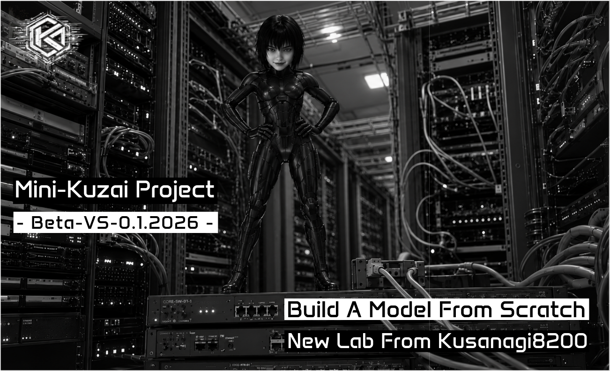

#### **`Mini-Kuzai - LLM`**

#### **`BUILD A LANGUAGE MODEL FROM SCRATCH, TRAIN IT LOCALLY AND INSPECT WHAT HAPPENS INSIDE A TRANSFORMER.`**

&#8202;&#8202;&#8202;&#8202;&#8202;&#8202;&#8202;

---

## Project overview

**Mini-Kuzai** is an experimental autoregressive language model developed **from scratch** with Python and PyTorch, trained and inspected locally using NVIDIA CUDA. It is not built from pretrained weights and is not intended to be a production chatbot.

The project progresses from a fully inspectable Transformer laboratory to a small conversational model with a distinct identity. Its priorities are **curiosity, creative and cognitive development, reasoned disagreement, uncertainty, opinion revision and multi-turn consistency**, rather than specialist technical expertise.

Each stage is documented through source code, reproducible protocols, frozen checkpoints, diagnostic reports and explicit authorization boundaries.

## Navigate the project

**[Phases](#development-phases)** · **[Research steps V48-V74](#phase-03-research-steps)** · **[Current status](#current-status---2026-11-01)** · **[Source code and operations](#code-operations-and-evidence)** · **[Full original documentation](README-DETAILED-20261031T192526Z.md)**

## Development phases

| Phase | Purpose | Documentation |
| --- | --- | --- |
| **01 - Transformer fundamentals** | Tokenization, attention, MLP, LayerNorm, training, ablations and frozen tiny model | [Phase 01](phases/MINI-KUZAI-PHASE-01.md) · [Source manifest](technical/PHASE-01-SOURCE-MANIFEST.md) |
| **02 - Inference** | Autoregressive decoding and KV-cache experiments | [Phase 02](phases/MINI-KUZAI-PHASE-02.md) |
| **03 - Conversational Mini-Kuzai** | Persona, curated corpus, Byte-BPE, new architecture, controlled training and diagnostic evaluation | [Phase 03 overview](phases/MINI-KUZAI-PHASE-03.md) · [Identity](phases/MINI-KUZAI-PHASE-03-IDENTITY.md) · [Behavior matrix](phases/MINI-KUZAI-PHASE-03-BEHAVIOR-MATRIX.md) |

## Phase 03 research steps

Read the steps in order, or open the relevant protocol directly. The detailed historical narrative remains available in the [archived original README](README-DETAILED-20261031T192526Z.md).

| Steps | Focus and result | Detailed documentation |
| --- | --- | --- |
| **V48-V52** | Public SmolTalk semantic reviews and cognitive/creative selection priorities | [V50 policy](phases/MINI-KUZAI-PHASE-03-V50-COGNITIVE-CREATIVE-PRIORITY.md) · [V51 review](phases/MINI-KUZAI-PHASE-03-V51-SEMANTIC-REVIEW.md) · [V52 results](reviews/smoltalk-v52/RESULTS-001.md) |
| **V53-V55** | Controlled corpus consolidation, VALIDATION closure and BLIND TEST freeze | [V53](phases/MINI-KUZAI-PHASE-03-V53-CORPUS-CONSOLIDATION.md) · [V54](phases/MINI-KUZAI-PHASE-03-V54-VALIDATION-CLOSURE.md) · [V55](phases/MINI-KUZAI-PHASE-03-V55-BLIND-FREEZE.md) |
| **V56-V58** | Byte-BPE tokenizer, conversation serialization and 1.18M-parameter Transformer baseline | [V56](phases/MINI-KUZAI-PHASE-03-V56-TOKENIZER-DESIGN.md) · [V57](phases/MINI-KUZAI-PHASE-03-V57-ARCHITECTURE-PREPARATION.md) · [V58](phases/MINI-KUZAI-PHASE-03-V58-ARCHITECTURE-BASELINE.md) |
| **V59** | Training mix, segmentation, public-source quality gates and frozen preparation | [V59 protocol](phases/MINI-KUZAI-PHASE-03-V59-TRAINING-MIX-SEGMENTATION.md) |
| **V60-V62** | Bounded training, EOS objectives, boundary margins and mandatory cycle-2 stop | [V62 run pipeline](phases/MINI-KUZAI-PHASE-03-V62-RUN-001-GOGIT-PIPELINE.md) · [V62 pause checkpoint](phases/MINI-KUZAI-PHASE-03-V62-PAUSE-CHECKPOINT-2026-10-28.md) |
| **V63-V64** | Generation robustness, EOS behavior, runtime profiling and language-learning evaluation | [V63 decoding](phases/MINI-KUZAI-PHASE-03-V63-DECODING-ROBUSTNESS-001.md) · [V64 diagnostic](phases/MINI-KUZAI-PHASE-03-V64-LANGUAGE-LEARNING-DIAGNOSTIC-002.md) |
| **V65-V66** | Token-frequency learning and byte/BPE prediction bias | [V65](phases/MINI-KUZAI-PHASE-03-V65-TOKEN-FREQUENCY-DIAGNOSTIC-001.md) · [V66](phases/MINI-KUZAI-PHASE-03-V66-TOKEN-PREDICTION-BIAS-001.md) |
| **V67-V68** | Output concentration, tied output head, embedding norms and logit margins | [V67](phases/MINI-KUZAI-PHASE-03-V67-OUTPUT-CONCENTRATION-001.md) · [V68](phases/MINI-KUZAI-PHASE-03-V68-OUTPUT-HEAD-DIAGNOSTIC-001.md) |
| **V69-V70** | In-memory output-norm counterfactual and BF16/FP32 precision control | [V69](phases/MINI-KUZAI-PHASE-03-V69-OUTPUT-NORM-COUNTERFACTUAL-001.md) · [V70](phases/MINI-KUZAI-PHASE-03-V70-PRECISION-CONTROL-001.md) · [V70 GOGIT results](reports/assistant-results/history/PHASE03-SMOLTALK-V70-PRECISION-CONTROL-001.json) |
| **V71 - GOGIT verified** | Frozen V62 norm-versus-direction attribution, 30 numeric metrics; 275 changed argmax positions out of 9170 | [V71 research protocol](phases/MINI-KUZAI-PHASE-03-V71-OUTPUT-DOMINANCE-ATTRIBUTION-001.md) · [V71 audit](tools/public-audits/phase03_v71_output_dominance_attribution_001.py) · [V71 tests](tests/test_phase03_v71_output_dominance_attribution_001.py) |
| **V72 - GOGIT verified** | Strong 128D anisotropy: centered PC1 82.88%, effective rank 1.44; mean-center switches 2889/9170 lexical predictions | [V72 protocol and findings](phases/MINI-KUZAI-PHASE-03-V72-HIDDEN-STATE-ANISOTROPY-001.md) · [V72 numeric GOGIT](reports/assistant-results/history/PHASE03-SMOLTALK-V72-HIDDEN-STATE-ANISOTROPY-001.json) |
| **V73 - GOGIT verified** | PC1 alone yields 2455/9170 correct predictions with only 2 distinct output IDs; removing PC1 yields 1124/9170 correct despite 522 distinct IDs | [V73 findings](phases/MINI-KUZAI-PHASE-03-V73-PRINCIPAL-AXIS-ATTRIBUTION-001.md) · [V73 GOGIT](reports/assistant-results/history/PHASE03-SMOLTALK-V73-PRINCIPAL-AXIS-ATTRIBUTION-001.json) |
| **V74 - CORE/STRATA GOGIT verified** | TRAIN unigram 2535/9170 correct vs PC1_ONLY 2455/9170; 2449 of 2455 PC1 hits shared with unigram. Research audit complete, FINAL-DEV-FLOW not yet triggered | [V74 results and limitations](phases/MINI-KUZAI-PHASE-03-V74-FREQUENCY-PRIOR-CONTROL-001.md) · [CORE GOGIT](reports/assistant-results/history/PHASE03-SMOLTALK-V74-FREQUENCY-PRIOR-CORE-001.json) · [STRATA GOGIT](reports/assistant-results/history/PHASE03-SMOLTALK-V74-FREQUENCY-PRIOR-STRATA-001.json) |

## Current status - 2026-11-01

| Component | Verified state |
| --- | --- |
| **Hardware** | Ubuntu 24.04 / RTX 5060 Laptop GPU 8 GB |
| **Model** | Decoder-only Transformer, 1,184,512 parameters |
| **Tokenizer** | Byte-BPE, 1024-token vocabulary |
| **Controlled corpus** | 107 TRAIN / 36 VALIDATION / 36 BLIND conversations |
| **Training inventory** | 345 segments, frozen V59 mixture |
| **Checkpoint V62** | Frozen after 69 optimizer steps and 597,982 exposed tokens |
| **V70** | **GOGIT published and verified**, commit [`d239bcf509be`](https://github.com/Kusanagi8200/Mini-Kuzai/commit/d239bcf509be2113ea8d8807487a57ec6116b00f) |
| **VALIDATION cross-entropy** | BF16 original 4.733 / FP32 original 4.732 / HALF 4.892 / FULL 5.048 |
| **Observed limitation** | Only 4-5 distinct original-projection argmax tokens across 9,170 lexical validation positions |
| **Safety** | No new training authorized, V62 unchanged, BLIND remains closed |
| **V71 status** | Read-only GPU GOGIT completed at [commit dcac14ea](https://github.com/Kusanagi8200/Mini-Kuzai/commit/dcac14ea7286642ec0cd9a670dded7fd981bd99c); **275/9170 argmax changed (3.00%)**, 5 to 7 predicted IDs, CE 4.732 to 5.048 |
| **V72 status** | **GPU/GOGIT verified** at [commit `41aed7aef84c`](https://github.com/Kusanagi8200/Mini-Kuzai/commit/41aed7aef84c832e78ae2ac7bfc2f8cd681bd1b7), original lexical top-1 correct 2673, mean-centered 2832; no new training |
| **V73 status** | **GOGIT verified**, [commit `1dcd4e8dc613`](https://github.com/Kusanagi8200/Mini-Kuzai/commit/1dcd4e8dc6138992486f70cdee3620751c4f2940). Removing PC1 changes 6841/9170 argmax decisions and reduces lexical top-1 accuracy from 30.88% to 12.26%. No training / BLIND access |
| **V74 status** | **Dual GOGIT verified**, [CORE `54dace24112f`](https://github.com/Kusanagi8200/Mini-Kuzai/commit/54dace24112f920232cb6106422f6da7ab35d24c) and [STRATA `7b36b3fb18c6`](https://github.com/Kusanagi8200/Mini-Kuzai/commit/7b36b3fb18c6f31037f90ada947b56469f73424f). Frozen TRAIN-unigram baseline outperforms PC1_ONLY by 80 correct predictions; safety gates 0 |

**V70-V74 finding -->** V71 equalizing output-head norms changed just 275/9170 lexical predictions. V72 found a centered hidden-state participation ratio of 1.44/128D and PC1 containing 82.88% of centered variance. V73 now shows that **deleting PC1 increases distinct predicted IDs from 15 to 522 but reduces correct predictions from 2832 to 1124**; removing PC1 plus PC2 yields 715 distinct IDs and only 818 correct. **PC1 alone** yields 2455 correct predictions from only 2 predicted IDs. This is an in-sample teacher-forced diagnostic: diversity without preserved accuracy is not useful learning. Keep V62 frozen, do not treat any ablation as a model patch, and do not use BLIND or restart training. V74 confirms that 2449 of 2455 PC1_ONLY correct predictions coincide with a context-free TRAIN unigram baseline, which correctly predicts 2535 tokens. The result strongly supports a frequency-prior explanation, but cannot establish an independent causal effect or generalization because PC axes were fitted on VALIDATION. Next decision --> design an independent, predeclared evaluation before any new training proposal.

## DEV-FLOW and V74 checkpoint - 2026-11-01

The latest verified scientific GOGIT is **V74**, published as two immutable numeric reports, [CORE](reports/assistant-results/history/PHASE03-SMOLTALK-V74-FREQUENCY-PRIOR-CORE-001.json) and [STRATA](reports/assistant-results/history/PHASE03-SMOLTALK-V74-FREQUENCY-PRIOR-STRATA-001.json). The reviewed [V74 research conclusion](phases/MINI-KUZAI-PHASE-03-V74-FREQUENCY-PRIOR-CONTROL-001.md) supports a strong TRAIN-frequency confound for PC1_ONLY and sets out limitations. The authorized [START Discussion #5](https://github.com/Kusanagi8200/Mini-Kuzai/discussions/5) and [START receipt](automation/dev-flow/receipts/V74-start.json) remain published.

The `fhc2` DEV-FLOW worker published the approved V74 START and the GitHub receipt. The real signed webhook reached KUZ-DIN, SQLite PREPARE found one eligible event `start-V74-d5`, and the guarded LinkedIn DELIVERY service sent exactly one post, confirmed by provider URN `urn:li:share:7522669773583872000` and operator screenshot. The production cutoff `2026-11-01T13:38:23+00:00` remains in force. **LinkedIn LIVE=YES**, DELIVERY timer active/enabled, no pending events and no duplicate replay. A follow-up timer check confirmed LAST `2026-11-01 14:51:36 UTC`, NEXT `2026-11-01 14:52:37 UTC`, and six successful `STATE=IDLE` runs with no additional post. The first real FINAL/GOGIT closing publication remains untested.

[DEV-FLOW deployment evidence and V74 GOGIT checkpoint](docs/DEV-FLOW-REPRISE-2026-11-01.md). V74 START and both scientific GOGIT records are complete; a public FINAL-DEV-FLOW is still pending a separate explicit order, and the final publication must reference both complementary reports. No documentation commit authorizes training, BLIND access or an external post.

## Code, operations and evidence

| Entry point | Content |
| --- | --- |
| [Model implementations](mini_kuzai/README.md) | Transformer code and model variants |
| [Installation](technical/installation/README.md) | Reference environment and setup |
| [Checkpoint inventory](technical/checkpoints/README.md) | Historical Phase 01 checkpoint metadata |
| [GOGIT](tools/GOGIT.md) | Verified numeric audit publication, immutable history and manual ChatGPT review |
| [GitHub Discussions and KUZ-DIN Publisher](docs/discussions/README.md) | Approved V74+ START / GOGIT events, signed GitHub webhook and guarded live LinkedIn delivery verified for START V74 |
| [DEV-FLOW checkpoint and V74 GOGIT review](docs/DEV-FLOW-REPRISE-2026-11-01.md) | Verified two-host publishing, V74 paired numeric GOGIT, pending FINAL authorization |
| [AUTOPILOT](autopilot/README.md) | Bounded diagnostic campaigns, reproducibility checks and training restrictions |
| [Latest GOGIT report](reports/assistant-results/latest.json) | Most recently published numerical results |
| [Workflow policy](PROJECT-WORKFLOW-POLICY.md) | Fail-closed automation and authorization boundaries |
| [Private-corpus methodology](phases/MINI-KUZAI-PHASE-03-PRIVATE-CORPUS-PIPELINE.md) | Public process description only - private source data remains local |

## README maintenance

Update this project index **after verified major milestones**, such as a frozen corpus/architecture revision, published GOGIT diagnostic, approved protocol or controlled training stop. Keep the current state, research-step links and next action accurate; preserve detailed methods and older results in their dedicated documents. **Code publication is not execution**, historical authorization is never renewed implicitly, and there is no automatic ChatGPT polling. The enabled local DEV-FLOW worker polls committed explicit requests, and cannot create a research step on its own.

The [original full README snapshot](README-DETAILED-20261031T192526Z.md) preserves the longer chronology, older experiment notes, architecture tables and historical decisions **without rewriting them**. Some historical status blocks there are superseded by the verified V74 status above.

All new training requires a separate, reviewed protocol and explicit authorization. Historical V62 approval does not authorize continuation. No BLIND TEST evaluation is triggered by documentation or GOGIT.

---

##### **`THE KUZ NETWORK - KUSANAGI8200 - @2026`**
